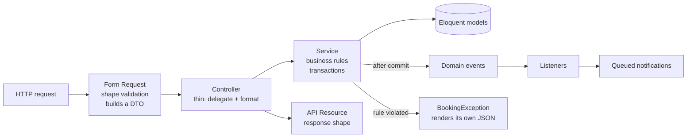

# Booking API

[](https://github.com/matiazar/booking-api/actions/workflows/tests.yml)


A small appointment-booking REST API (professionals, working hours, available slots, bookings and cancellations) built with Laravel.

The domain is intentionally small. The point of this repository is **how the code is organized**: the same conventions I use in client projects and in my own SaaS products, which are private.

---

## Architecture in one picture



| Layer | Folder | Responsibility | Never does |
|-------|--------|----------------|------------|
| Form Request | `app/Http/Requests` | Validates input shape, builds a typed DTO | Business rules |
| Controller | `app/Http/Controllers/Api` | Calls one service method, returns a Resource | Queries, validation, `DB::` |
| DTO | `app/Data` | Immutable, typed input for a use case | Logic |
| Service | `app/Services` | Business rules, transactions, events | Touch `Request` or HTTP |
| Value object | `app/ValueObjects` | `TimeSlot`: UTC-normalized range with `overlaps()` | Persistence |
| Exceptions | `app/Exceptions` | One class per rule violation, stable error codes | Get reported as bugs |
| Resource | `app/Http/Resources` | Public JSON contract | Leak internal columns |

Because services receive DTOs instead of a `Request`, the same `AppointmentService::book()` can be called from a controller, a queued job, a console command or a test without faking HTTP.

**These rules are enforced, not just documented.** `tests/Arch/ArchitectureTest.php` uses Pest architecture testing to fail the build if, for example, a controller uses `DB` or `Validator`, a service imports anything from `App\Http`, or a DTO is not `readonly`.

---

## Design decisions (and their trade-offs)

**One source of truth for availability.** `AvailabilityService::slotsFor()` lists free slots, and `isAvailable()` validates a booking by checking membership in that same list. Listing and booking can never disagree about what "free" means (working hours, split shifts, lead time, booking window, slot grid, overlaps). Trade-off: validating one booking computes the whole day; for a single professional's day that's a few dozen slots, so clarity wins.

**No double booking under concurrency.** Booking runs in a transaction that first takes a row lock on the professional (`lockForUpdate`). Two simultaneous requests for the same agenda are serialized (MySQL/PostgreSQL; SQLite already serializes writes), and the second one sees the first appointment and gets `409 slot_unavailable`. Trade-off: bookings for the *same* professional are serialized; different professionals don't block each other.

**Time zones done explicitly.** Working hours are stored in the professional's local time; appointments are stored in UTC; the API speaks ISO-8601 and accepts any offset. Slots are generated in local time, so a "09:00 opening" stays 09:00 across DST changes.

**Business errors vs. bugs.** Rule violations (`SlotUnavailableException`, `AppointmentNotCancellableException`) extend `BookingException`: they render a consistent `{ message, error }` JSON with a machine-readable code and are excluded from error reporting. Everything else is a bug and is **emailed to the admin**, throttled to one mail per exception signature every 10 minutes so an error loop can't flood the inbox, and disabled in `local`/`testing`. The reporter itself can never throw.

**Side effects after commit.** `AppointmentBooked` / `AppointmentCancelled` implement `ShouldDispatchAfterCommit`, so a customer is never emailed about a booking that was rolled back. Notifications are queued.

**Public ids are ULIDs.** Appointment ids are unguessable but still sortable, so `GET /appointments/{id}` doesn't expose a sequential counter.

**Rules in config, not in code.** Slot interval, lead time, booking window and cancellation notice live in `config/booking.php` and can be tuned per environment.

### Deliberately out of scope

Kept out to keep the repo focused, not because they don't matter: authentication (in production I'd use Sanctum, with Policies called from `authorize()` in the Form Requests), payments, rescheduling, and multi-tenancy.

---

## API

Base URL: `/api/v1`

| Method | Endpoint | Description |
|--------|----------|-------------|
| `GET` | `/professionals` | Paginated professionals with their appointment types |
| `GET` | `/professionals/{id}/availability?appointment_type_id=&date=YYYY-MM-DD` | Free slots for a local day |
| `POST` | `/appointments` | Book a slot |
| `GET` | `/appointments/{ulid}` | Appointment details |
| `POST` | `/appointments/{ulid}/cancel` | Cancel (respects the notice window) |

<details>
<summary>Example: book an appointment</summary>

```http
POST /api/v1/appointments
Content-Type: application/json

{
  "appointment_type_id": 1,
  "starts_at": "2026-11-03T09:00:00-03:00",
  "customer_name": "Ana Pérez",
  "customer_email": "ana@example.com"
}
```

```json
{
  "data": {
    "id": "01jc8z6t3k9v2q4m7n5p8r1s0w",
    "status": "confirmed",
    "starts_at": "2026-11-03T12:00:00Z",
    "ends_at": "2026-11-03T12:30:00Z",
    "customer": { "name": "Ana Pérez", "email": "ana@example.com" },
    "professional": { "id": 1, "name": "Dr. Laura Gómez", "timezone": "America/Argentina/Buenos_Aires" },
    "appointment_type": { "id": 1, "name": "Check-up", "duration_minutes": 30, "price_cents": 2000000 },
    "cancelled_at": null,
    "cancellation_reason": null
  }
}
```

If the slot was taken in the meantime:

```json
HTTP/1.1 409 Conflict

{ "message": "The selected time is not available.", "error": "slot_unavailable" }
```

</details>

---

## Running it

Requirements: PHP 8.3+, Composer, SQLite.

```bash
git clone https://github.com/matiazar/booking-api.git
cd booking-api
composer setup        # install, .env, key, SQLite database, migrations + demo data
php artisan serve
```

```bash
curl "http://localhost:8000/api/v1/professionals"
```

## Tests

```bash
php artisan test      # unit + feature + architecture
vendor/bin/pint       # code style
```

The suite covers the availability rules (split shifts, overlaps, lead time, booking window, days off), booking and cancellation flows, validation, error rendering, admin error reporting and its throttling, plus the architecture rules above. Time is frozen in tests, so they don't depend on when they run.

---

Built by **Matias Azar** - full-stack developer and tech lead, 25+ years building web platforms.
[LinkedIn](https://www.linkedin.com/in/matiazar)
